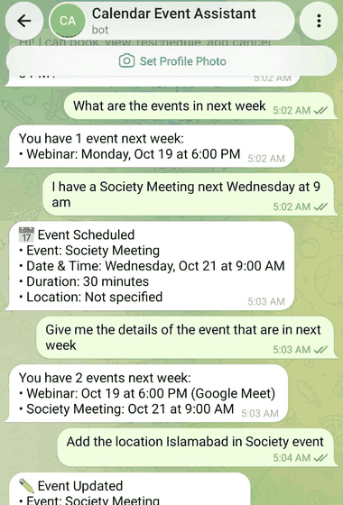
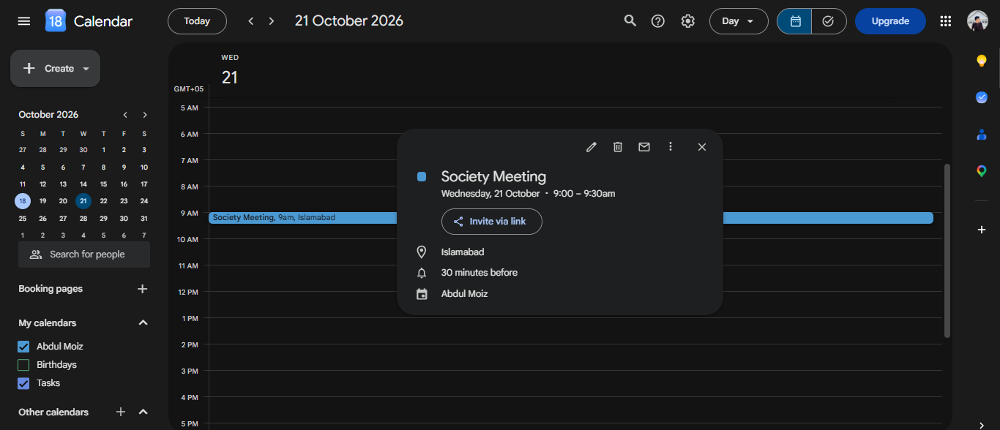
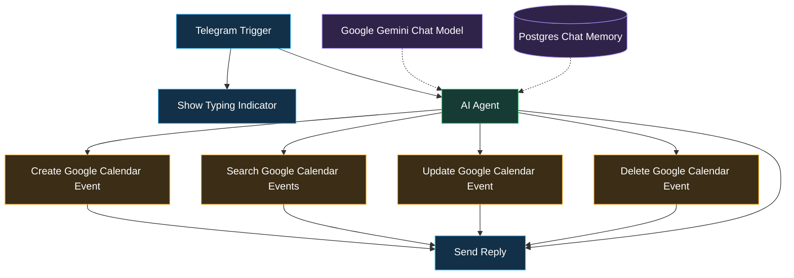
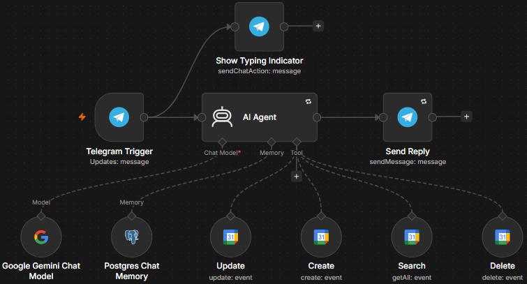

 <div align="center">


<br/>

<a href="#about"></a>
<a href="#features"></a>
<a href="#how"></a>
<a href="#nodes"></a>
<a href="#stack"></a>
<a href="#setup"></a>

<br/><br/>


<br/><br/>



</div>

<a id="about"></a>

## About

Managing a calendar through a mobile app means tapping through multiple screens just to create one event. Most users already live inside a chat app, so this project brings calendar management directly into Telegram.

Send a plain-language message to the Telegram bot. The AI assistant interprets the request, selects the appropriate calendar operation, executes it through Google Calendar, and returns the result in the same chat.

**No forms. No menus. No manual calendar navigation. Just chat.**

**Sample requests the assistant can handle:**

<div align="center">


<br/>



</div>

### At a Glance

| Metric | Value |
|---|---|
| Workflow nodes | 10 |
| Calendar operations | 4 — Create, Search, Update, Delete |
| AI model | Google Gemini |
| Memory store | PostgreSQL |
| Default event duration | 30 minutes |
| Default timezone | Asia/Karachi |

---

<a id="features"></a>

## Features

- **Natural Language Input:** Manage calendar events using everyday messages instead of commands.
- **Full Calendar CRUD:** Create, search, update, and delete Google Calendar events.
- **AI-Powered Tool Selection:** Google Gemini helps the agent determine which calendar operation matches the user's request.
- **Conversation Memory:** PostgreSQL-backed chat history supports follow-up requests such as "Move it to 3 PM."
- **Live Feedback:** A typing indicator lets users know that their request is being processed.
- **Error Handling:** Retry-on-fail settings on configured nodes and a separate Error Trigger workflow help manage failures.
- **Sensible Defaults:** The assistant uses the `Asia/Karachi` timezone and a default event duration of 30 minutes when configured to do so.
- **Conversational Interaction:** Users can manage their calendar without learning special bot commands.

---

<a id="how"></a>

## Architecture

The workflow connects Telegram, an AI agent, a language model, conversation memory, and Google Calendar operations.

### Workflow Diagram



### Request Lifecycle

1. **Receive:** The Telegram Trigger receives a message and starts the workflow.
2. **Acknowledge:** The Show Typing Indicator node provides feedback while the request is processed.
3. **Understand:** The AI Agent uses Google Gemini to interpret the request. Postgres Chat Memory provides relevant conversation history.
4. **Select and Execute:** The agent chooses the appropriate Google Calendar tool to create, search, update, or delete an event.
5. **Respond:** The Send Reply node sends the result to the user's Telegram chat.

<div align="center">



</div>

<a id="nodes"></a>

## Nodes

The workflow contains 10 nodes, each responsible for a specific part of the automation.

| Node | Responsibility |
|---|---|
| **Telegram Trigger** | Receives incoming Telegram messages and starts the workflow. |
| **Show Typing Indicator** | Displays a typing indicator while the assistant processes a request. |
| **AI Agent** | Interprets the request and decides which calendar tool to use. |
| **Google Gemini Chat Model** | Provides language understanding and generates AI responses. |
| **Postgres Chat Memory** | Stores and retrieves conversation history for follow-up messages. |
| **Create Google Calendar** | Creates new calendar events. |
| **Search Google Calendar** | Retrieves existing calendar events. |
| **Update Google Calendar** | Modifies existing event details. |
| **Delete Google Calendar** | Deletes selected calendar events. |
| **Send Reply** | Sends the assistant's response to Telegram. |

---

<a id="stack"></a>

## Tech Stack

| Component | Role |
|---|---|
| **n8n Cloud** | Workflow automation and orchestration |
| **Telegram Bot API** | Chat interface for user interaction |
| **Google Gemini** | Language understanding and decision-making |
| **Google Calendar API** | Calendar event management |
| **PostgreSQL** | Conversation memory persistence |
| **JSON** | Workflow export and import format |
| **Mermaid** | Architecture diagram rendering |

---

<a id="structure"></a>

## Repository Structure

```text
.
├── README.md
├── <workflow>.json
└── assets/
    ├── telegram-conversation.gif
    ├── calendar-result.png
    └── workflow.png
```

**File descriptions:**

- `README.md` — Project documentation and setup instructions.
- `<workflow>.json` — Exported n8n workflow; replace this placeholder with your actual filename.
- `telegram-conversation.gif` — Animated Telegram conversation demo.
- `calendar-result.png` — Screenshot of a calendar event created by the assistant.
- `workflow.png` — Screenshot of the n8n workflow canvas.

---

<a id="setup"></a>

## Setup

### Prerequisites

Before importing the workflow, prepare the following:

- An **n8n Cloud** account or a compatible self-hosted n8n instance.
- A **Telegram bot token** from [@BotFather](https://t.me/BotFather).
- A **Google Gemini API key**.
- A **Google account** with Google Calendar access.
- A **PostgreSQL database** for chat memory.

### Installation

1. **Download the workflow:** Obtain the exported n8n JSON file from this repository.
2. **Import into n8n:** Open n8n and select the workflow import option to import the JSON file.
3. **Configure Telegram:** Create Telegram credentials and attach them to the Telegram Trigger, Show Typing Indicator, and Send Reply nodes.
4. **Configure Gemini:** Add your Gemini API credentials to the Google Gemini Chat Model node.
5. **Configure Google Calendar:** Connect your Google account using OAuth and assign the appropriate credentials to all four calendar tools.
6. **Configure PostgreSQL:** Enter the database connection details in the Postgres Chat Memory node and verify that the database is reachable.
7. **Review node settings:** Check the AI Agent instructions, calendar tool parameters, memory session identifier, and timezone settings.
8. **Activate and test:** Activate the workflow and send a test message to your Telegram bot.

> **Important:** The exported workflow does not provide your credentials. You must connect your own Telegram bot, Google account, Gemini API key, and PostgreSQL database. Calendar operations will affect the Google Calendar associated with your configured credentials.

## Usage Examples

Send any of the following messages to your Telegram bot:

| Request | Expected Action |
|---|---|
| `Schedule my class meeting tomorrow at 10 AM` | Create an event |
| `What events do I have this week?` | Search events |
| `Move my meeting to 3 PM` | Update an event, if it can identify the correct meeting |
| `Delete the class meeting` | Delete the matching event |
| `Add Islamabad as the location of my meeting` | Update the event location |
| `Show me the details of my next meeting` | Search and return event details |

## Future Improvements

- Add confirmation before deleting or significantly changing events.
- Detect scheduling conflicts before creating events.
- Support recurring events and reminders.
- Improve handling of ambiguous event names and relative dates.
- Add automated tests for common calendar operations.
- Expand error notifications and execution monitoring.
